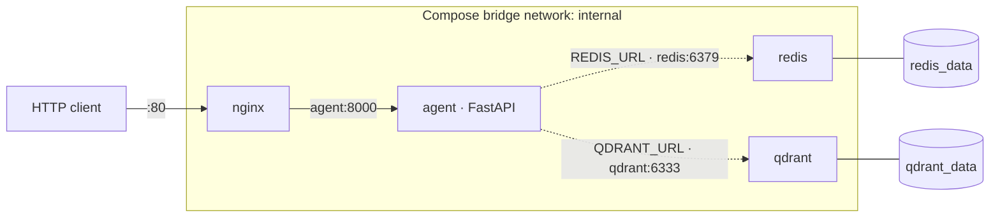

# Day 14 Lab - Mission Answers

## Part 1: Localhost vs Production

### Exercise 1.1: Anti-patterns found

Các số dòng dưới đây nằm trong [develop/app.py](01-localhost-vs-production/develop/app.py).

1. **Ghi thông tin xác thực trực tiếp trong mã nguồn (dòng 17–18).** Ví dụ chứa khóa LLM giả và URL database có thông tin đăng nhập mẫu. Nếu dùng thông tin thật, người có quyền đọc repo có thể lấy chúng từ lịch sử Git, kể cả sau khi xóa khỏi file hiện tại. Bản production đọc khóa từ môi trường tại [production/config.py](01-localhost-vs-production/production/config.py#L26).
2. **Ghi khóa API và nội dung request/response ra stdout (dòng 33–38).** Log tập trung có thể cho nhiều người và hệ thống quyền đọc, làm tăng phạm vi lộ khóa và dữ liệu người dùng. Bản production chỉ ghi metadata của request/response, như độ dài và IP, tại [production/app.py](01-localhost-vs-production/production/app.py#L110).
3. **Cố định địa chỉ và cổng (dòng 51–52).** Bind vào `localhost` giới hạn kết nối vào loopback. Cổng cố định cũng có thể khác cổng do nền tảng cấp. Bản production đọc `HOST` và `PORT` từ môi trường.
4. **Luôn bật auto-reload (dòng 53).** Chế độ này theo dõi thay đổi file và có thể khởi động lại tiến trình khi mã nguồn đổi. Bản production để `DEBUG=false` mặc định và chỉ bật reload khi có yêu cầu qua cấu hình.
5. **Thiếu probe cho liveness và readiness (dòng 25–39).** Chỉ có route gốc và route hỏi agent, nên hệ thống điều phối thiếu tín hiệu riêng để kiểm tra tiến trình và quyết định có nên chuyển traffic tới instance. Bản production có [`/health` và `/ready`](01-localhost-vs-production/production/app.py#L135).
6. **Thiếu hook dọn tài nguyên khi tắt (dòng 13).** Bản develop khởi tạo FastAPI mà không đăng ký lifespan riêng. Bản production dùng [lifespan](01-localhost-vs-production/production/app.py#L39) cho startup và shutdown, có chỗ để cập nhật trạng thái readiness và dọn tài nguyên.

### Exercise 1.2: Develop version test results

Chạy Uvicorn với `app:app` trong thư mục `develop/`, bind vào loopback với cổng tạm và tắt reload cho lần kiểm tra này. Gửi `question` qua query string.

| Request | HTTP | Kết quả thực tế |
| --- | --- | --- |
| `POST /ask?question=Hello` | 200 | `{"answer":"Tôi là AI agent được deploy lên cloud. Câu hỏi của bạn đã được nhận."}` |
| `GET /health` | 404 | `{"detail":"Not Found"}` |

### Exercise 1.3: Comparison table

| Feature | Develop | Production | Why Important? |
| --- | --- | --- | --- |
| Cấu hình và secret | Giá trị khai báo trực tiếp trong mã | `Settings` đọc biến môi trường, kiểm tra `AGENT_API_KEY` khi `ENVIRONMENT=production` | Có thể dùng cùng mã nguồn giữa các môi trường và đổi secret mà không sửa mã. |
| Host, port và reload | `localhost:8000` và luôn bật reload | Đọc `HOST`, `PORT`, `DEBUG` từ môi trường | Container có thể nhận kết nối qua interface phù hợp và dùng cổng do nền tảng cấp. |
| Health check | Thiếu probe riêng | `GET /health` báo liveness, `GET /ready` báo readiness | Hệ thống điều phối có thể ngừng gửi traffic khi instance chưa sẵn sàng và xử lý instance lỗi theo cấu hình probe. |
| Logging | `print()` ghi cả khóa và nội dung request/response | Dùng logger, sự kiện có các trường như `event`, `question_length` và `response_length` | Metadata hỗ trợ tra cứu và tổng hợp log mà không cần lưu khóa hay nội dung câu hỏi. |
| Shutdown | Dựa vào Uvicorn, thiếu hook riêng của app | Uvicorn xử lý shutdown, FastAPI lifespan thực hiện phần dọn dẹp của app và đặt `is_ready=False` | Graceful shutdown cho request đang xử lý thời gian hoàn tất trong giới hạn cấu hình và cho ứng dụng cơ hội giải phóng tài nguyên. |

Bản production chạy bằng `python app.py` với `HOST=127.0.0.1`, cổng tạm, `DEBUG=false` và mock LLM. Kết quả thực tế:

- `POST /ask` với JSON `{"question":"Hello"}` → **200**, trả câu hỏi, câu trả lời mock và trường `model`.
- `GET /health` → **200**, `status=ok`.
- `GET /ready` → **200**, `ready=true`.

Phần shutdown trong bảng được đối chiếu từ mã. Lần chạy này kiểm tra các endpoint HTTP trên Windows.

## Part 2: Docker

### Exercise 2.1: Dockerfile questions

1. **Base image:** `python:3.11`.
2. **Working directory:** `/app` trong container. Các lệnh copy đến `.`, cài dependencies và chạy app sử dụng thư mục này.
3. **Why copy requirements first?** Docker có thể tái sử dụng layer cài dependencies khi chỉ sửa `app.py`. Nếu copy source trước, việc sửa source có thể làm mất cache của các bước cài dependencies phía sau.
4. **CMD vs ENTRYPOINT:** `ENTRYPOINT` dạng exec xác định lệnh chạy chính. Khi có cả hai ở dạng exec, `CMD` cung cấp đối số mặc định, và đối số sau tên image trong `docker run` thay thế `CMD`. Dockerfile này dùng riêng `CMD ["python", "app.py"]` làm lệnh mặc định.

### Exercise 2.2: Build and run

Dùng gốc repo làm build context vì `COPY` tham chiếu `02-docker/develop/` và `utils/`. Bản develop nhận `question` qua query string.

| Request | HTTP | Kết quả thực tế |
| --- | --- | --- |
| `GET /health` | 200 | `{"status":"ok","uptime_seconds":1.0,"container":true}` |
| `POST /ask?question=What%20is%20Docker%3F` | 200 | `{"answer":"Container là cách đóng gói app để chạy ở mọi nơi. Build once, run anywhere!"}` |

### Exercise 2.3: Image size comparison

- **Builder:** `python:3.11-slim`, cài `gcc` và `libpq-dev`, rồi cài dependencies Python vào `/root/.local`.
- **Runtime:** stage riêng từ `python:3.11-slim`, copy dependencies đã cài và mã ứng dụng, chạy Uvicorn bằng user `appuser`. Base slim nhỏ hơn và runtime không mang theo các gói chỉ dùng lúc build.

- Develop: **1.670 MB** (`1.67GB` trong output `docker images`).
- Production: **240 MB** (`240MB` trong output `docker images`).
- Difference: production nhỏ hơn **khoảng 85,6%**, tính bằng `(1670 - 240) / 1670 × 100%` từ hai giá trị đã làm tròn của `docker images`.

Docker Engine 29.5.2. Cột `Size` của `docker images` biểu thị kích thước trên đĩa. Lần chạy cũng ghi được `docker image inspect --format '{{.Size}}'` là `426319888` byte cho develop và `57409047` byte cho production. Bảng so sánh dùng số của `docker images` theo yêu cầu CP2. [Docker CLI reference](https://docs.docker.com/reference/cli/docker/image/ls/#format-the-output).

### Exercise 2.4: Docker Compose stack



Compose khởi động Redis và Qdrant, đợi health check của hai service này đạt rồi mới khởi động agent. Nginx nhận HTTP ở cổng 80 và chuyển tiếp tới `agent:8000` trên mạng nội bộ. Đường nét đứt biểu thị địa chỉ dependency do Compose cấu hình. Agent mẫu gọi mock LLM và chưa đọc hai URL đó để phục vụ `/ask`.

Log của `docker compose up --wait` xác nhận cả bốn service `agent`, `nginx`, `qdrant` và `redis` đã chạy. `docker compose down` đã dừng các container và gỡ mạng của project CP2 sau khi kiểm tra.

- `GET /health` qua Nginx → **200**, `status=ok`, `version=2.0.0`.
- `POST /ask` với JSON `{"question":"Explain microservices"}` qua Nginx → **200**, trả trường `answer` từ mock LLM.

## Part 3: Cloud Deployment

### Exercise 3.2: Render deployment

- URL: https://day14-ai-agent-6shl.onrender.com
- Render báo Live ở commit `881102d`. Kiểm tra public nhận `/health` **200**, `/ready` **200**, `POST /ask` thiếu key **401** và có key **200**. Xem bảng kết quả tại [DEPLOYMENT.md](DEPLOYMENT.md#test-results).

| Nội dung | Railway (`railway.toml`) | Render (`render.yaml`) |
| --- | --- | --- |
| Phạm vi | File TOML mô tả cách build và deploy một service agent. | Blueprint YAML mô tả cả web service và Key Value trong cùng file. |
| Docker build | `builder = "DOCKERFILE"` và `dockerfilePath = "Dockerfile"`, với source ở `06-lab-complete/`. | `runtime: docker`, `rootDir: 06-lab-complete`, Docker context là thư mục đó. |
| Health check | `healthcheckPath = "/health"`, timeout 60 giây trong cấu hình mẫu. | `healthCheckPath: /health` cho web service. |
| Redis và secret | Tạo Redis riêng trên nền tảng và đặt `REDIS_URL` cùng `AGENT_API_KEY` vào biến môi trường của agent. | `fromService` lấy connection string nội bộ của Key Value. `sync: false` để nhập `AGENT_API_KEY` qua dashboard. |

Chọn Render vì Blueprint có thể tạo agent và Redis nội bộ trong cùng lần deploy. Railway đã ngừng cho service mới dùng Config as Code dạng TOML hoặc JSON, nên `railway.toml` được đối chiếu theo mẫu của lab. [Render Blueprints](https://render.com/docs/infrastructure-as-code) · [Railway Config as Code](https://docs.railway.com/config-as-code)

### Exercise 3.3: Cloud Run CI/CD pipeline

1. `cloudbuild.yaml` cài dependencies cùng pytest và chạy bộ test trong image Python 3.11.
2. Bước build dùng Docker để gắn tag `$COMMIT_SHA` và `latest` vào image, rồi bước push đưa cả hai tag lên registry đã khai báo.
3. Bước deploy chạy `gcloud run deploy` ở `asia-southeast1` với image theo commit, cho phép truy cập public và lấy secret từ Secret Manager.
4. `service.yaml` là cấu hình khai báo riêng để dùng với `gcloud run services replace`. File đặt port 8000, scale 1–10 instance, concurrency 80, liveness tại `/health` và startup probe tại `/ready`.

## Part 4: API Security

### Exercise 4.1-4.3: Test results

**4.1 — API key**

`POST /ask` khai báo `Depends(verify_api_key)`. Dependency đọc header `X-API-Key` qua `APIKeyHeader` và đối chiếu với `AGENT_API_KEY`. Thiếu header trả **401**, key sai trả **403**. Để xoay khóa trong bản mẫu, cập nhật biến môi trường của service, khởi động lại tiến trình rồi cập nhật key ở client. Bản mẫu đọc một khóa lúc khởi động. [develop/app.py](04-api-gateway/develop/app.py#L35)

Trích output `curl -i` với cùng body `{"question":"Hello"}`:

```http
HTTP/1.1 401 Unauthorized
content-type: application/json

{"detail":"Missing API key. Include header: X-API-Key: <your-key>"}

HTTP/1.1 403 Forbidden
content-type: application/json

{"detail":"Invalid API key."}

HTTP/1.1 200 OK
content-type: application/json

{"question":"Hello","answer":"Tôi là AI agent được deploy lên cloud. Câu hỏi của bạn đã được nhận."}
```

**4.2 — JWT**

Đăng nhập tài khoản demo `student` qua `POST /auth/token`. Server kiểm tra thông tin đăng nhập và ký JWT bằng HS256. Token chứa `sub`, `role`, `iat` và `exp`, có hiệu lực 60 phút. Client gửi `Authorization: Bearer <token>` vào `POST /ask`. Dependency xác minh chữ ký và thời hạn rồi lấy username và role. [production/auth.py](04-api-gateway/production/auth.py#L22)

Trích output `curl -i` khi cấp token và khi gọi `/ask` bằng token đó. Giá trị token và đoạn gợi ý trong response đã được che.

```http
HTTP/1.1 200 OK
content-type: application/json

{"access_token":"[REDACTED]","token_type":"bearer","expires_in_minutes":60,"hint":"Include in header: Authorization: Bearer [REDACTED]"}

HTTP/1.1 200 OK
content-type: application/json

{"question":"Explain JWT","answer":"Tôi là AI agent được deploy lên cloud. Câu hỏi của bạn đã được nhận.","usage":{"requests_remaining":9,"budget_remaining_usd":1.9e-05}}
```

Gọi `/ask` khi thiếu Bearer token trả `HTTP/1.1 401 Unauthorized` và header `www-authenticate: Bearer`.

**4.3 — Rate limiting**

Mỗi username có một deque lưu timestamp. Khi có request, limiter bỏ timestamp cũ hơn 60 giây và đếm những request còn trong cửa sổ trượt. User có hạn mức **10 request/60 giây**. Server chọn limiter theo role đã xác minh trong JWT. Admin có hạn mức **100 request/60 giây** và vẫn chịu giới hạn đó. [production/rate_limiter.py](04-api-gateway/production/rate_limiter.py#L17) · [production/app.py](04-api-gateway/production/app.py#L137)

Trong 20 lần gọi liên tiếp bằng cùng JWT, tính cả lần gọi ở bài 4.2, request **1–10** trả **200** và **11–20** trả **429**. Trích output của request 11:

```http
HTTP/1.1 429 Too Many Requests
x-ratelimit-limit: 10
x-ratelimit-remaining: 0
retry-after: 59
content-type: application/json

{"detail":{"error":"Rate limit exceeded","limit":10,"window_seconds":60,"retry_after_seconds":59}}
```

### Exercise 4.4: Cost guard implementation

Bản mẫu kiểm tra ngân sách trước khi gọi mock LLM và tính chi phí từ số token đầu vào, đầu ra sau khi có phản hồi. Nó lưu tổng trong bộ nhớ, giới hạn **1 USD/ngày cho mỗi user** và **10 USD/ngày toàn dịch vụ**. Đạt giới hạn của user trả **402**, còn đạt giới hạn toàn dịch vụ trả **503**. Rate limit giới hạn số lượt gọi trong 60 giây, trong khi cost guard tính tiền theo số token và đơn giá. Một request dài có thể tốn hơn nhiều request ngắn. [production/cost_guard.py](04-api-gateway/production/cost_guard.py#L39)

Với biến thể **10 USD/tháng cho mỗi user** trong đề, dùng key Redis `budget:{user_id}:{YYYY-MM}` theo UTC. Trước khi gọi LLM, ước tính chi phí và kiểm tra rồi giữ chỗ trong một thao tác nguyên tử để các request đồng thời cùng thấy ngân sách đúng. Nếu tổng vượt ngưỡng, trả **402**. Sau khi có kết quả, cập nhật khoản giữ chỗ theo chi phí thực tế hoặc hoàn lại khi lời gọi thất bại. Tháng mới dùng key mới. TTL dọn key cũ. Đây là phương án thiết kế cho bài 4.4 theo yêu cầu CP3.

## Part 5: Scaling & Reliability

### Exercise 5.1-5.5: Implementation notes

**5.1 — Health checks**

`/health` là liveness probe. Nó cho biết tiến trình còn phản hồi và trong bản develop có thêm chẩn đoán bộ nhớ từ `psutil`. `/ready` cho biết instance đã sẵn sàng nhận traffic. Bản develop đặt cờ readiness trong FastAPI lifespan và trả **503** khi cờ tắt. Trong bản production, nếu instance đang dùng Redis và ping Redis lỗi, `/health` vẫn trả HTTP 200 với `status=degraded`, còn `/ready` trả 503. [develop/app.py](05-scaling-reliability/develop/app.py#L104) · [production/app.py](05-scaling-reliability/production/app.py#L187)

Đã chạy bản develop với Uvicorn trên loopback và đối chiếu ba endpoint:

| Request | HTTP | Kết quả |
| --- | --- | --- |
| `GET /health` | 200 | `status=ok`, `version=1.0.0`, kiểm tra bộ nhớ đã chạy với `psutil` |
| `GET /ready` | 200 | `{"ready":true,"in_flight_requests":1}` |
| `POST /ask?question=hello` | 200 | Trả trường `answer` từ mock LLM |

**5.2 — Graceful shutdown**

Uvicorn tiếp nhận SIGTERM, ngừng nhận kết nối mới và chờ request đang xử lý trong thời hạn graceful shutdown. Lifespan dọn trạng thái của app, đặt `_is_ready=False` và ghi log shutdown. Bản develop mô phỏng một request chậm khoảng ba giây. [develop/app.py](05-scaling-reliability/develop/app.py#L42)

Chạy lại agent develop trong container Linux bằng image đã build ở CP4 và mount mã mẫu develop. `GET /health` và `GET /ready` đều trả **200** trước phép thử. Trong container này, phần chẩn đoán bộ nhớ dùng nhánh dự phòng vì thiếu `psutil`. Lần kiểm tra develop trên Windows ở mục 5.1 đã chạy với `psutil`.

Script gửi `POST /ask?question=hello`, đợi 0,5 giây, xác nhận request chưa hoàn tất rồi gửi SIGTERM. Request trả **200** với câu trả lời mock và container tự thoát với mã **0**.

```text
POST /ask after SIGTERM: 200
Container exit code: 0
INFO:     Shutting down
INFO:     Waiting for application shutdown.
2026-11-26 14:03:16,353 INFO 🔄 Graceful shutdown initiated...
2026-11-26 14:03:16,353 INFO ✅ Shutdown complete
INFO:     Application shutdown complete.
INFO:     Finished server process [1]
2026-11-26 14:03:16,354 INFO Received signal 15 — uvicorn will handle graceful shutdown
```

**5.3 — Stateless design**

Mỗi instance có bộ nhớ riêng, nên lưu lịch sử trong dict của từng tiến trình sẽ làm mất ngữ cảnh khi Nginx chuyển request sau sang replica khác. Bản production dùng cùng Redis và khóa `session:<session_id>`. Mỗi lượt `/chat` lưu hai message `user` và `assistant`. Mẫu giữ tối đa 20 message và làm mới TTL 3.600 giây khi ghi. Nếu Redis không kết nối được lúc khởi động, bản mẫu fallback sang bộ nhớ và không đáp ứng yêu cầu chia sẻ session giữa replica. [production/app.py](05-scaling-reliability/production/app.py#L34)

**5.4 — Load balancing**

Client gọi Nginx ở `localhost:8080`. Nginx chuyển tiếp tới upstream `agent:8000` trên mạng Compose. Trường `served_by` cho biết instance thực sự xử lý từng request. [docker-compose.yml](05-scaling-reliability/production/docker-compose.yml#L18) · [nginx.conf](05-scaling-reliability/production/nginx.conf#L3)

`docker compose ps` xác nhận cả ba replica `agent-1`, `agent-2`, `agent-3` đều healthy, cùng với Redis đang healthy và Nginx đang chạy. `GET /health` qua Nginx trả **200**, `storage=redis` và `redis_connected=true`. Log startup cho thấy cả ba replica đã kết nối Redis.

**5.5 — Test stateless**

`test_stateless.py` gửi năm request `POST /chat` tuần tự với cùng `session_id`, ghi lại các instance trong `served_by`, rồi truy vấn `GET /chat/{session_id}/history`. Lịch sử đầy đủ sẽ có 10 message. Script mẫu không dừng replica trong quá trình chạy. [test_stateless.py](05-scaling-reliability/production/test_stateless.py#L40)

Kết quả thực tế từ `test_stateless.py`:

| Request | `served_by` |
| --- | --- |
| 1 | `instance-8dd187` |
| 2 | `instance-e6f70e` |
| 3 | `instance-6c2437` |
| 4 | `instance-8dd187` |
| 5 | `instance-e6f70e` |

Cả ba replica đã phục vụ cùng một session. Endpoint lịch sử trả đủ **10 message**, gồm năm câu hỏi và năm phản hồi theo thứ tự. Log xác nhận `docker compose down` đã dọn các container và mạng của stack.

## Part 6: Final Project

### Checklist Deliverable

Chạy đầy đủ `python check_production_ready.py` trên Ubuntu 24.04 (WSL2) với Docker Engine 29.5.2. Image được script chấm đo là **63 MB**. Rate limiter vẫn trả **429** sau khi restart agent. Khi nhận SIGTERM, request đang xử lý vẫn trả **200** và tiến trình thoát mã **0**. `docker stop` hoàn tất trong **0,9 giây**.

```text
  Result: 12/12 tiêu chí đạt · 43/43 checks passed
  🎉 PASS 12/12 — PRODUCTION READY!
```

Kiểm tra HTTP cục bộ khi Redis không kết nối được xác nhận `/health` trả **200** và `/ready` trả **503**. `/ask` trả **401** khi thiếu hoặc sai key, **422** khi câu hỏi chỉ có khoảng trắng và **503** khi request hợp lệ nhưng Redis không khả dụng. Cả tám dòng log của app trong lần kiểm tra đều parse được thành JSON.

Redis dùng sorted set để giữ rate limit mỗi API key qua các worker và qua lần restart agent. Cost guard giữ chỗ ngân sách ngày theo UTC trước khi gọi mock LLM, sau đó quyết toán theo token đầu vào và đầu ra. Hai thao tác kiểm tra rồi cập nhật quota và ngân sách chạy nguyên tử trong Redis. FastAPI lifespan đóng Redis client khi Uvicorn hoàn tất shutdown.

## AI log

- **CP1.** Yêu cầu Codex đọc hai bản agent, xác định anti-pattern và đối chiếu hành vi qua HTTP.
- **CP2.** Yêu cầu Codex đọc Dockerfile và Compose theo Part 2. Codex giải thích layer cache và multi-stage. Tính tỷ lệ chênh lệch từ `docker images`.
- **CP3.** Yêu cầu Codex đọc JWT, rate limiter và cost guard của repo, rồi kiểm tra mã HTTP. Codex chạy hai agent mẫu trên loopback với khóa tạm, dùng curl để đo token trong báo cáo.
- **CP4.** Yêu cầu Codex đọc bản mẫu scaling, kiểm tra probe và chuẩn bị kiểm tra SIGTERM, ba replica và session Redis.
- **CP5.** Yêu cầu Codex hoàn thiện agent Part 6, cấu hình Docker và cloud theo checklist. Codex triển khai auth, rate limit và cost guard dùng Redis; tôi chạy `check_production_ready.py` trong Ubuntu WSL2 với Docker và kiểm tra kết quả `PASS 12/12`.
- **CP6.** Yêu cầu Codex soạn cấu hình Render và hướng dẫn kiểm tra URL public. Tôi tạo Blueprint, nhập API key trên Render, chạy kiểm tra HTTP 200/200/401/200 rồi chụp dashboard, trạng thái chạy và kết quả test.
- **CP7.** Yêu cầu Codex chạy benchmark local và điền đúng mẫu. Codex thêm histogram độ dài câu hỏi, chạy bảy lượt load test, đọc hai lỗi từ baseline v2 rồi bổ sung tài liệu HPA và JWT. Codex chạy lại eval với gate 100%, đối chiếu 10 JSON và ghi kết quả vào BENCHMARK_REPORT.md.
- **CP8.** Yêu cầu Codex chuẩn bị và đọc kết quả Locust, Prometheus, Grafana và Jaeger. Tôi chạy script trong Ubuntu WSL2, chụp dashboard có tải, hai alert cùng firing, trace chậm và trace lỗi. Codex đối chiếu số liệu JSON/CSV, hoàn thiện `BENCHMARK_REPORT.md` theo mẫu và đưa bốn ảnh vào `screenshots/`.
